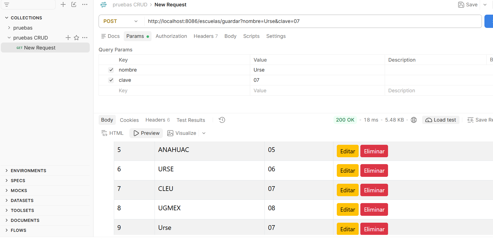
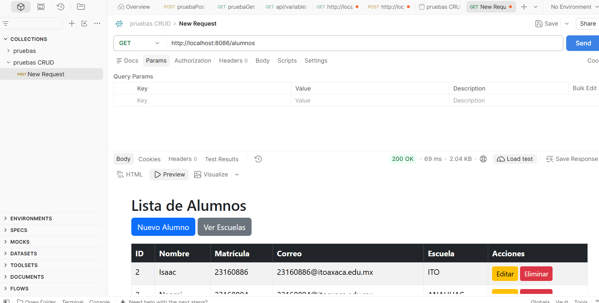
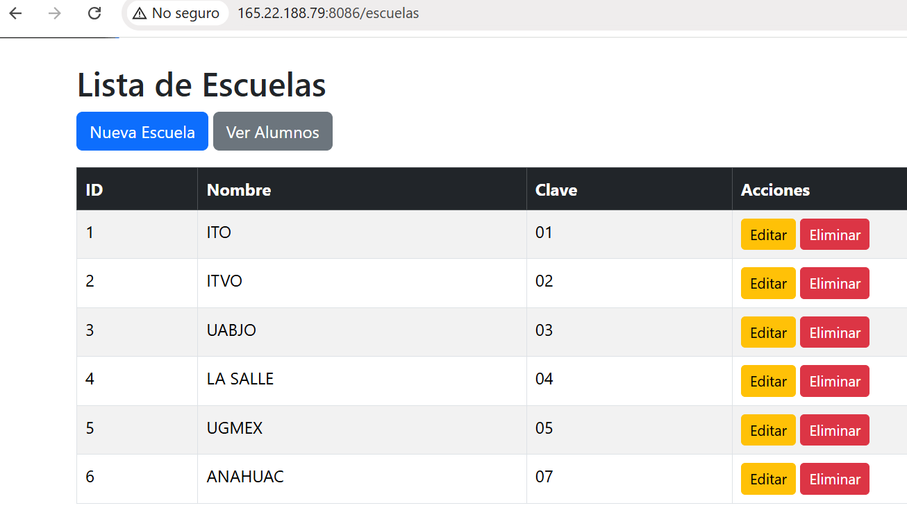

# DMIEact3_t4 - CRUD en Spring Boot y Relaciones

## Descripción de la Actividad
La aplicación gestiona un sistema de control escolar enfocado en dos entidades principales: `Escuela` y `Alumno`. Permite realizar todas las operaciones **CRUD** (Crear, Leer, Actualizar y Eliminar) sobre ambas entidades y expone sus endpoints mediante servicios RESTful.

##  Relación de Entidades
- **`Escuela` (`@OneToMany`):** Una escuela puede estar asociada a múltiples alumnos.
- **`Alumno` (`@ManyToOne`):** Muchos alumnos pertenecen a una misma escuela.

## Evidencia de Pruebas y Funcionamiento (CRUD)

### 1. Operación CREATE (Crear Registro)
*Descripción:* Captura del envío de una petición `POST` desde Postman insertando un nuevo alumno asignado a una escuela existente. Respuesta exitosa con código HTTP `201 Created`.

---

### 2. Operación READ (Consultar Registro con Relación)
*Descripción:* Captura de la consulta mediante una petición `GET`. Muestra la estructura JSON del `Alumno` recuperado, donde se visualiza el objeto completo de su `Escuela` asociada.

---

### 3. Operación UPDATE (Actualizar Registro)
*Descripción:* Petición `PUT` realizando la modificación de los datos de un alumno o escuela previamente registrado, recibiendo una respuesta exitosa `200 OK` con los datos actualizados.

---

### 4. Operación DELETE (Eliminar Registro)
*Descripción:* Petición `DELETE` removiendo exitosamente un registro específico por su ID de la base de datos, retornando la confirmación de eliminación.

---

## Despliegue en VPS Producción
- **URL Base:** `http://165.22.188.79:8086/escuelas`