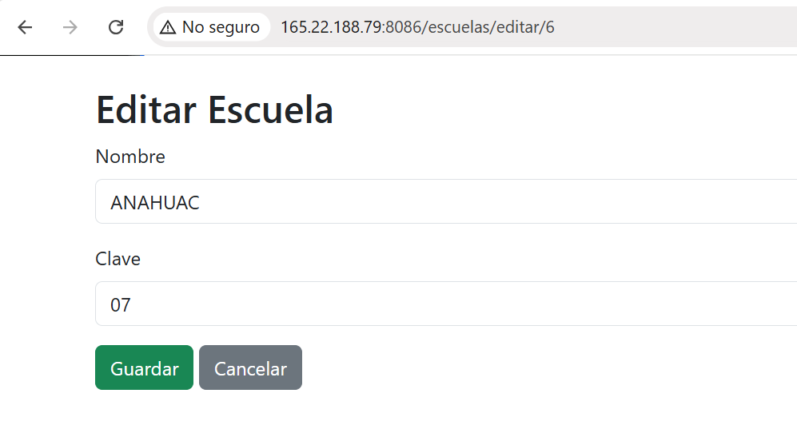

# DMIEact3_t4 - CRUD en Spring Boot y Relaciones

## Descripción de la Actividad
La aplicación gestiona un sistema de control escolar enfocado en dos entidades principales: `Escuela` y `Alumno`. Permite realizar todas las operaciones **CRUD** (Crear, Leer, Actualizar y Eliminar) sobre ambas entidades y expone sus endpoints mediante servicios RESTful.

##  Relación de Entidades
- **`Escuela` (`@OneToMany`):** Una escuela puede estar asociada a múltiples alumnos.
- **`Alumno` (`@ManyToOne`):** Muchos alumnos pertenecen a una misma escuela.

## Evidencia de Pruebas y Funcionamiento (CRUD)

### 1. Operación CREATE (Crear Registro)
*Descripción:* Envío de una petición `POST` hacia la ruta `/escuelas/guardar` desde Postman, enviando los parámetros `nombre` y `clave`. Respuesta exitosa con código HTTP `200 OK`.

---

### 2. Operación READ (Consultar Registro con Relación)
Consulta realizada mediante una petición `GET` a la ruta `/escuelas`. Demuestra la recuperación de registros.

---

### 3. Operación UPDATE (Actualizar Registro)
*Descripción:* Ejecución en navegador mostrando el apartado de modificación de datos sobre un registro existente de Escuela.

---

### 4. Operación DELETE (Eliminar Registro)
*Descripción:* Visualizacion del boton eliminar de un registro seleccionando su identificador (ID) y verificando su remoción de la lista de la base de datos.

---

## Despliegue en VPS Producción
- **URL Base:** 
`http://165.22.188.79:8086/escuelas`
`http://165.22.188.79:8086/alumnos`